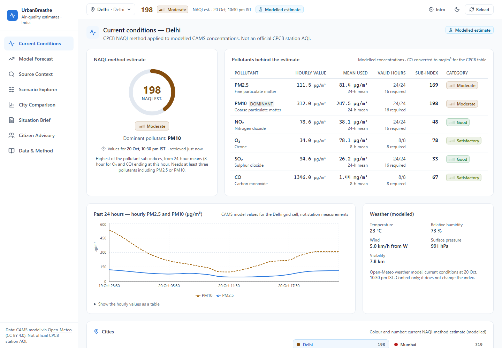

<div align="center">

# UrbanBreathe

**Transparent air-quality estimates for ten Indian cities — with the source, time and method behind every number.**

[Live app](https://urban-breathe-nine.vercel.app) · [Data & method](docs/methodology/naqi.md) · [API](#api) · [Run locally](#run-locally-windows-powershell)

</div>

> **Data basis.** All air-quality values are **modelled** — output of the CAMS global atmospheric-composition model served by Open-Meteo (≈45 km grid over India). Applying the CPCB National AQI formula to them gives a **NAQI-method estimate**, which is *not* the official CPCB station AQI. Check [airquality.cpcb.gov.in](https://airquality.cpcb.gov.in) for official measurements.



## What it answers

| Question | Where |
|---|---|
| What does the available data indicate, and which pollutant drives it? | **Current Conditions** — estimate, per-pollutant means, valid-hour counts and CPCB sub-indices |
| Where does the data come from and how fresh is it? | Every view: data-basis badge, “values for” hour and retrieval age; **Data & Method** page |
| What does the model forecast suggest — and how far can it be trusted? | **Model Forecast** — past 24 h vs next 72 h, explicitly *not evaluated* |
| Which sources matter? | **Source Context** — descriptive indicators only; no apportionment is claimed |
| What might an intervention change, under stated assumptions? | **Scenario Explorer** — editable, labelled assumptions; arithmetic, not prediction |
| What should people do? | **Citizen Advisory** — quoted CPCB health statement + general precautions (EN/HI/BN/TE) |
| How do cities compare? | **City Comparison** — ranked table with metric, timestamps and a screening caveat |
| Can I hand this to someone? | **Situation Brief** — printable, with data basis and limitations |

What it deliberately does **not** do: no station data, no forecast accuracy claims, no source percentages, no health/cost/lives-saved figures, no anomaly detection (needs a historical baseline). Demo fixtures exist only behind `DATA_MODE=demo` and are always labelled **DEMO**.

## Architecture

```
Browser (React 18 + TypeScript + Vite + Tailwind + Recharts)
  AppShell  ── hash routes  #<view>/<city>   e.g. #forecast/mumbai
   ├─ Header: city selector · current estimate · data time · theme · reload
   ├─ Current Conditions (eager)   ├─ Model Forecast   ├─ Source Context
   ├─ Scenario Explorer            ├─ City Comparison  ├─ Situation Brief
   └─ Citizen Advisory             └─ Data & Method          (others lazy-loaded)
        │  fetch /api/*  (timeouts, abort on city change, JSON errors)
        ▼
Vercel: rewrite /api/* → api/index.js (Express app)      Local: Vite proxy → :3001
  server/app.js        routes, security headers, CDN cache headers, JSON errors
  server/http          request validation (city ids, interventions, assumptions)
  server/services      cityAirQuality → forecast · sourceIndicators · scenario · brief · advisory
  server/domain        naqi.js (CPCB method) · units.js · season.js
  server/providers     openMeteo.js  (timeout, bounded body, 10-min cache, shared in-flight
                                      requests, schema + unit checks, honest retrievedAt)
        ▼
Open-Meteo Air Quality API (CAMS)  +  Open-Meteo forecast API (weather)
```

Every city request fetches one 6-day hourly CAMS series (2 days back, 4 ahead) and one current-weather record; all views for that city are computed from the same cached series, so they agree.

## Run locally (Windows PowerShell)

Requires npm and Node.js 20+ to build and run; `npm test` runs TypeScript test files directly and needs Node.js 22.18+ (verified on Node 24.14).

```powershell
git clone https://github.com/CodesbyRohit/UrbanBreathe.git
Set-Location UrbanBreathe
npm ci

# API on http://localhost:3001 and Vite dev server on http://localhost:5173 (proxies /api)
npm start

# Or production build + preview (preview also proxies /api to :3001)
npm run build
Start-Process npm -ArgumentList 'run','server'
npx vite preview          # http://localhost:4173
```

Demo mode (no network calls; every response labelled DEMO):

```powershell
$env:DATA_MODE = 'demo'; npm run server
```

### Configuration

No secrets or API keys are needed. Optional variables (see [.env.example](.env.example); the server reads the process environment, it does not load `.env` files):

| Variable | Default | Purpose |
|---|---|---|
| `DATA_MODE` | live | `demo` serves labelled fixtures instead of Open-Meteo |
| `PORT` | `3001` | Local API port (the Vite proxy expects 3001) |
| `CORS_ORIGINS` | empty | Comma-separated origins allowed to call the API cross-origin. Empty = same-origin only (the deployed setup) |

### Checks

```powershell
npm run typecheck   # tsc for app + config
npm test            # node:test — NAQI, units, API validation/errors, provider failures, caching, scenarios, frontend utilities
npm run build       # tsc -b && vite build
```

## API

All responses are JSON. Errors: `{ "error": { "code": "...", "message": "...", "details"?: {...} } }` with 400 (invalid input), 404 (unknown city/route), 413 (body too large), 503 (provider unavailable — never replaced by substitute data; `Retry-After: 60` when rate-limited).

| Method | Path | Returns |
|---|---|---|
| GET | `/api/health` | `{ status, timestamp }` |
| GET | `/api/cities` · `/api/cities/:id` | City id, name, state, centre coordinates, time zone |
| GET | `/api/air-quality/:cityId` | Estimate (`aqi`, `aqiStatus`, `aqiCategory`, `naqi.subIndices` with means, valid hours, windows), hourly values at `referenceTime`, last-24 h PM history, modelled weather, `provenance` |
| GET | `/api/forecast/:cityId` | `recent` (past 24 h) and `points` (next 72 h) with NAQI-method estimates, `peak`, `retrievedAt`, `evaluated: false` |
| GET | `/api/sources/:cityId` | Descriptive indicators (PM2.5/PM10 ratio, dominant pollutant) — no apportionment |
| GET | `/api/simulation/interventions` | Catalogue with placeholder reduction fractions |
| POST | `/api/simulation/run` | Body `{ cityId, interventions: string[], assumptions?: { [id]: { [pollutant]: 0–0.9 } } }` → baseline vs scenario, per-pollutant table, assumptions with their source |
| POST | `/api/brief/generate` | Body `{ cityId, interventions?, assumptions? }` → situation brief |
| GET | `/api/advisory/:cityId?lang=en\|hi\|bn\|te` | CPCB health statement, guidance (with `messageLang` fallback), precautions, 112 |

Example (abridged) — `GET /api/air-quality/delhi`:

```json
{
  "cityId": "delhi",
  "referenceTime": "2026-10-20T17:00:00.000Z",
  "aqi": 198, "aqiStatus": "ok", "aqiCategory": "Moderate",
  "naqi": {
    "dominantPollutants": ["pm10"], "basis": "modelled", "officialCpcb": false,
    "subIndices": { "pm10": { "averagingHours": 24, "validHours": 24, "requiredHours": 16,
                              "average": 247.5, "unit": "ug/m3", "subIndex": 198, "category": "Moderate" } }
  },
  "provenance": { "mode": "live", "airQuality": { "provider": "open-meteo", "kind": "modelled",
                  "model": "CAMS global atmospheric composition forecast", "retrievedAt": "2026-10-20T16:59:39Z" } }
}
```

Caching: the server caches each provider response for 10 minutes (per instance) and reports the original `retrievedAt`. Successful GET responses carry `Cache-Control: no-cache` for browsers and `Vercel-CDN-Cache-Control: max-age=60, stale-while-revalidate=60` for Vercel's CDN; errors and POSTs are `no-store`.

## Method and data integrity

- **NAQI** — `server/domain/naqi.js`, CPCB CUPS/82/2014-15 Table 3.11 breakpoints; 24-h means (8-h for O₃, CO); ≥16 valid hours for 24-h means, all 8 for 8-h means; ≥3 pollutants including PM2.5 or PM10; “subtract one from I<sub>LO</sub>” rule; open-ended Severe reported as `401+`. Open questions and choices are listed in [docs/methodology/naqi.md](docs/methodology/naqi.md).
- **Units** — Open-Meteo reports µg/m³; CO is converted to mg/m³ for the CPCB table. Unexpected units are rejected (503), not guessed.
- **Time** — provider times requested in GMT and handled as UTC; display uses the city time zone (IST). Running means never use hours after the reference hour.
- **Forecast** — CAMS values passed through unchanged. Not evaluated. A proper evaluation would need CPCB CAAQMS hourly observations, a time-ordered hold-out, a persistence baseline and error metrics by lead time and category.
- **Scenarios** — reductions are multiplied into the current means (`1 − Π(1 − r)` per pollutant) and the same NAQI code is re-run. Default fractions are uncited placeholders; users can replace them and the result labels which were edited.
- **Advisory** — the CPCB Table 3.12 statement is quoted verbatim and kept separate from the project’s own (translated) precaution text. Only the national emergency number 112 is listed; no local helplines are invented.

## Deployment (Vercel)

`vercel.json`: framework `vite`, `npm ci`, `npm run build`, output `dist`; rewrites `/api/(.*)` → `/api` (the Express app in `api/index.js`) and everything else → `index.html`; immutable caching for `/assets/*`; `X-Content-Type-Options`, `Referrer-Policy`, `X-Frame-Options`, `Permissions-Policy` on all routes. No environment variables are required in Vercel.

## Performance

Measured with Lighthouse 12.8.2 on 20 Oct 2026 against local production builds (`vite preview`, same machine, same local API; three runs each). The preview server does not compress responses, so absolute numbers differ from Vercel.

| Build | Mobile perf | Desktop perf | Accessibility | Best practices | SEO | Mobile LCP (median) | CLS |
|---|---|---|---|---|---|---|---|
| Before (commit `ba2b610`) | 80 / 85 / 80 | 98 / 99 / 99 | 96 | 96 mobile · 100 desktop | 100 | 3.5 s | 0.142 |
| After | 95 / 95 / 95 | 100 / 100 / 100 | 100 | 100 | 100 | 2.9 s | 0.000 |

The remaining LCP is dominated by waiting for live model data (the largest element is data-dependent text). Recharts (≈103 kB gzip) loads only when a chart is shown.

## Project layout

```
api/index.js                 Vercel function entry (exports the Express app)
server/                      Express API (see Architecture)
src/components/              layout/, dashboard/, forecast/, source-attribution/, simulator/,
                             comparative/, executive-brief/, citizen-advisory/, method/, common/
src/hooks/useResource.ts     race-safe data loading (abort + per-key results)
src/utils/                   provenance & formatting, ranking, scenario inputs, forecast series,
                             map projection, routes — dependency-free and unit-tested
tests/server, tests/frontend node:test suites
docs/methodology/naqi.md     NAQI sources, rules and open questions
```

## Limitations

- Modelled data at ≈45 km resolution; cannot represent street-level exposure or local hotspots.
- Forecast not evaluated; no accuracy is claimed.
- No source apportionment, anomaly detection, or health/economic estimates.
- Server cache is per serverless instance; Open-Meteo’s free tier is for non-commercial use (<10,000 calls/day).
- Ten cities only; coordinates are conventional city centres.
- Translations are the project’s own and cover the precautionary guidance only.
- The optional presentation intro uses the browser’s speech synthesis; quality varies by browser.

## Roadmap (not implemented)

- Ingest CPCB CAAQMS station data where licensing allows, show it alongside the model, and evaluate the forecast against it (persistence baseline, per-lead-time errors).
- Cited, city-specific intervention assumptions with references.
- Historical baseline for anomaly flags.

## Attribution and licence

Air-quality data: Copernicus Atmosphere Monitoring Service (CAMS) via [Open-Meteo](https://open-meteo.com/) (CC BY 4.0). Weather: Open-Meteo (CC BY 4.0). Method: CPCB, *National Air Quality Index* (CUPS/82/2014-15). India outline: Natural Earth (public domain).

Code licence: the project was described as MIT, but **no `LICENSE` file is present in the repository**; add one to make the licence explicit.

Originally built for the ET AI Hackathon 2.0 by [CodesbyRohit](https://github.com/CodesbyRohit).
